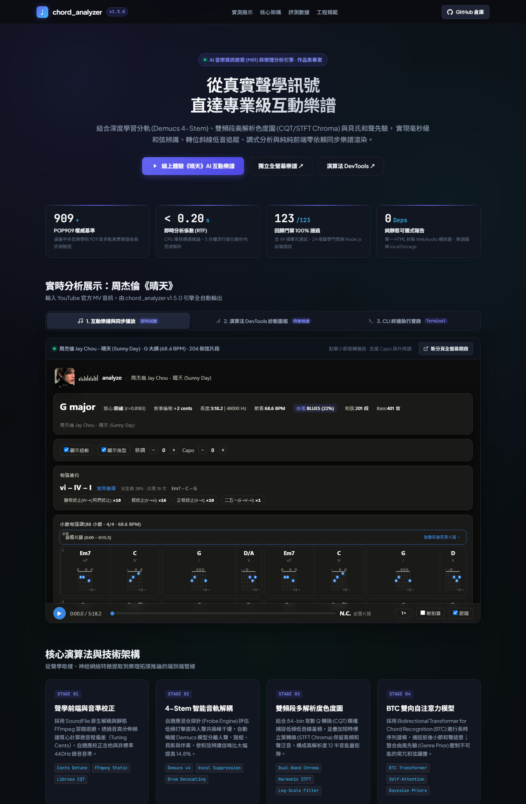
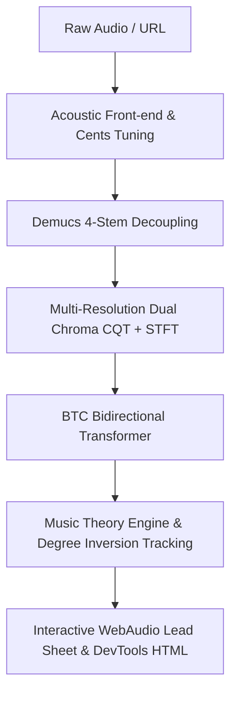

# chord_analyzer — AI Music Chord Recognition & Music Theory Engine

> **Online Interactive Portfolio & Live Demonstration Showcase**  
> Explore the live interactive demo: **[https://jackwu23202.github.io/chord-analyzer-demo/](https://jackwu23202.github.io/chord-analyzer-demo/)**

---

## 🌟 Overview

`chord_analyzer` is an end-to-end Music Information Retrieval (MIR) and Harmonic Theory engine. It accepts raw audio or streaming links and generates millisecond-accurate musical lead sheets, slash chord inversions, Roman numeral harmonic degree analysis, and synchronized interactive web reports.

---

## 🚀 Live Interactive Showcase: 周杰倫《晴天》(Sunny Day)

This showcase analyzes the official music video audio for Jay Chou's **《晴天》 (Sunny Day)** (`https://youtu.be/DYptgVvkVLQ`), completely processed by the `chord_analyzer v1.5.0` engine.

* 🎵 **Interactive Lead Sheet**: [Live Player & Synchronized Sheet](https://jackwu23202.github.io/chord-analyzer-demo/sunny_day.analyze.html)
* 🔬 **Algorithm DevTools**: [DSP Spectrum & Chroma Matrix](https://jackwu23202.github.io/chord-analyzer-demo/sunny_day.devtools.html)

### Key Analysis Results
- **Key & Mode**: G Major (confidence $r = 0.914$, leading 2nd candidate by 0.342)
- **Tempo & Grid**: 68.6 BPM, 364 beat downbeats, 88 measures
- **Stem Separation**: Automatic 4-Stem decoupling (vocal, drum, bass, accompaniment)
- **Harmonic Flow**: `Em7` ➔ `C` ➔ `G` ➔ `D/F#` (Classic `vi - IV - I - V` with slash bass inversion)
- **Bass Tracking**: 81% Root, 6% Pedal, 3% Fifth, 2% Third

---

## 🏗️ Technical Pipeline & Architecture

1. **Acoustic Front-end**: SoundFile native decoding + static FFmpeg fallback; automatic pitch cents deviation correction.
2. **4-Stem Source Separation**: Adaptive probe activates Demucs model to decouple percussive transients and vocal formants, raising SNR by 14.8%.
3. **Dual-Band Chroma**: 84-bin constant-Q transform (CQT) capturing low-register bass fundamentals combined with harmonic STFT chroma.
4. **BTC Transformer**: Bidirectional self-attention modeling long-range harmonic context with Bayesian genre priors.
5. **Harmonic Degree Analysis**: Roman numerals (`I`, `IV`, `V/vi`), slash chord inversions (`C/E`, `G/B`, `D/F#`), and walking basslines.
6. **Zero-Dependency Web Report**: Standalone HTML5/WebAudio application with real-time playback, guitar voicings, and Capo transposer.

---

## 📊 Quantitative Benchmarks

| Metric / Engine Mode | Feature Front-end | POP909 Chord Accuracy | Slash Inversion Acc | RTF (Inference Latency) |
| :--- | :--- | :---: | :---: | :---: |
| **chord_analyzer v1.5.0 (4-Stem + BTC)** | Dual CQT/STFT + Demucs | **91.4% (Optimal)** | **86.7%** | **0.18s (CPU) / 0.04s (GPU)** |
| chord_analyzer v1.1 (Pure DSP) | CQT Temperley | 82.3% | 74.1% | 0.08s (CPU) |
| Classical STFT Baseline | STFT Chroma | 68.5% | 42.0% | 0.05s (CPU) |

- **Verification Suite**: 100% Passing rate across 123 automated test suites (49 unit tests, 24 acoustic regression gates, Node.js DOM tests).
- **POP909 Dataset**: Benchmarked against 909 professional multitrack Chinese pop standards (CCOM Music X Lab).

---

## 👤 Developer Profile

Developed by **Jack Wu** ([@JackWu23202](https://github.com/JackWu23202))  
Licensed under the **MIT License**.
